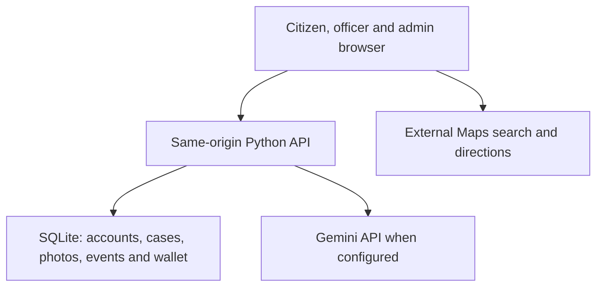

# SwachhSetu · Classic UI
A browser-based hackathon pilot for waste guidance, sanitation reporting and a Green Revolt wallet. See [AUDIT.md](AUDIT.md) for the proposal-to-code comparison.

## Demo login · one command

On Windows, extract the ZIP and double-click **Start_SwachhSetu.bat**. From a terminal you can run `python demo.py` or `py demo.py`. The launcher opens the correct browser address. Select **Continue as Citizen**, **Continue as Officer** or **Continue as Admin** on the Overview page. For manual sign-in, all three accounts below use password **SwachhDemo@2026**.

| Role | Email |
|---|---|
| Citizen | citizen@swachhsetu.demo |
| Officer | officer@swachhsetu.demo |
| Admin | admin@swachhsetu.demo |

The launcher runs on localhost with a separate `data/classic-demo.sqlite` database. If port 8000 is already in use, the launcher picks another free port and prints the exact URL. To use Gemini in the demo, run `python server.py --configure-gemini` once and restart the demo launcher.

## Local setup · simple Hinglish

1. ZIP extract karo. Folder ke andar terminal kholo. Python 3.10+ installed hona chahiye.
2. Admin aur officer accounts ek baar terminal se banao. Dono ke liye alag email aur minimum 12-character password enter karo. PowerShell mein zarurat pade toh `python` ki jagah `py` use karo.

   ```sh
   python server.py --create-staff admin
   python server.py --create-staff officer
   python server.py
   ```

3. Chrome ya Brave mein `http://127.0.0.1:8000` kholo. Citizen ke liye **Create account** select karo. Admin, officer aur citizen ko alag browser profiles mein kholo taaki teeno ki sessions independent rahen.
4. Terminal open rakho. Stop karne ke liye Ctrl+C. Restart ke baad reports aur accounts `data/swachhsetu.sqlite` se load honge. Fresh demo chahiye toh `--db data/demo.sqlite` teeno terminal commands mein use karo.

## Gemini setup and credential rotation

The uploaded HTML contained a Gemini key. Revoke it in the owning project, check recent usage and generate a fresh restricted key. Clear the old prototype's site data from browsers that ran it. If anyone entered a reused password in the original prototype, change it where it was reused. Staff accounts for this pilot are provisioned separately.

1. Create a fresh key in [Google AI Studio](https://aistudio.google.com/app/apikey).
2. From the project folder, run `python server.py --configure-gemini`. Paste the key at the hidden terminal prompt. Press Enter at the model prompt to use `gemini-2.5-flash`, or enter a model enabled for your project.
3. Start or restart with `python server.py`. Sign in as a citizen, open **Scanner**, and look for **Gemini key configured**. This status reflects local configuration. Run an actual scan to verify provider access.

The key is stored locally in `data/.swachhsetu-gemini.json` with the default database location. Keep that file private. Set `GEMINI_API_KEY` and `GEMINI_MODEL` in the server environment if you use a secret manager. Environment values take precedence. The ZIP and frontend contain no key. Manual classification and the labelled sample are available without Gemini. The classic release restores the original dark-green interface around the full-stack pilot.

**Upgrading from the first pilot:** copy your existing `data` folder into this project if you want to keep the existing SQLite accounts and records. Stop the old local server before copying it. If you already use a custom database path, pass the same `--db` value when setting up Gemini and starting the new server.

[Gemini GenerateContent API](https://ai.google.dev/api/generate-content)

## Architecture



Native HTML/CSS/JavaScript and Python + SQLite keep the demo installable without package managers or cloud accounts. The code retains the existing scanner/report/track/facilities/dashboard journeys and dark green identity. `migrations/001.sql` initializes a fresh database. `server.py` handles auth, role checks, case mutations, photos, ledger and Gemini. The browser never writes authoritative role, points or status values. SQLite transactions serialize case updates and ledger debits.

## Feature checklist

| Area | Included in this ZIP | Remaining |
|---|---|---|
| Authentication | Citizen registration, server sessions, role checks, profile names and CLI staff provisioning | Email verification, recovery, managed identity and staff MFA |
| Complaints | UUID references, editable GPS, before/after photos, officer assignment, timelines, restricted transitions, citizen confirmation and reopening | Official ward boundaries, automatic ward matching, AI priority, separate escalations queue and advanced admin verification |
| Duplicate review | Matching issue, distance, age and open status; repeat-safe supporter count | Image similarity, citizen tracking for supported cases and dedicated admin merge review |
| Scanner | Gemini request/validation code, manual and labelled sample, item/material text, ambiguous path, correction and history | Live provider verification, evaluated photo set and trained offline model |
| Municipal analytics | Role-visible queue, admin filters, daily and monthly trends, ward/officer/priority counts, relative GPS plot with cluster overlay, CSV, pilot SLA label | Map tiles, geographic density heatmap, PDF export and detailed officer SLA statistics |
| Rewards | Server ledger, 2 points per confirmed educational scan, 10 points per rolling day, transaction history and simulated redemption | Real rewards/partners, QR verification, leaderboards, achievements, challenges and verified field credits |
| Facilities | Unverified sample directory, type/distance filters and contextual Maps search | Verified locations, contact and verification provenance, embedded directory map and feedback moderation |
| Notifications | Recent activity from case events and wallet entries on a refreshed dashboard | Read/unread, active delivery, email, push and automated escalation |
| Mobile | Responsive forms, camera capture, app manifest, cached public shell and locally saved report text | Offline login/submission, persisted offline photos, voice input and Hindi interface |
| Smart-city integrations | Role-specific operational data and configurable pilot SLA | IoT, chatbot, pickup scheduling, route optimization and validated hotspot prediction |

## Pilot deployment

Run locally for the hackathon. The standard-library HTTP server is a development/demo transport. Before public deployment, move the handlers to a production server/framework, add HTTPS and secure-cookie enforcement, configure a deployment-wide rate limit and budget for Gemini, and test monitoring, backups and restoration. Store photos privately with full image decoding and canonical re-encoding at ingestion, upload quotas and retention policies. The current backend checks JPEG framing and size and the browser resizes images, but a direct API client can bypass browser re-encoding. If moving to PostgreSQL or Supabase, migrate the schema and add equivalent row-access policies and serialized wallet writes. Set a locally agreed SLA via `SLA_HOURS`. The default 48 hours is a demo setting. Photos and GPS may identify people. Define consent, retention and authorized access before using real municipal data.

A fresh database starts empty. Import of the original single-HTML demo’s browser users, passwords and demo state is not wired. Recreate demo accounts and cases. Local report drafts retain location and description on the device until submitted or browser data is cleared. Dashboard refresh is explicit through the normal action/load cycle. The public shell may load offline; credentials and case data need the local server.

## Demo walkthrough

1. Citizen selects **Scanner → Show demo sample**, confirms Dry and opens **Facilities**. The sample uses a prewritten PET bottle result. Use a real photo and the Gemini path only if configured and validated.
2. Citizen files an overflow complaint with a landmark, before photo and editable coordinates. Use clearly synthetic locations/photos during the presentation.
3. Admin opens **Municipal command center**, sets ward and officer on the complaint, then selects **Assigned**.
4. Officer signs in, moves the case to **In Progress**, uploads the after-cleaning proof and selects **Awaiting Verification**.
5. Citizen reloads, compares photos and chooses **Resolved**. To show reopening, choose **Reopened** with a remark before having the ward team repeat the cleanup.
6. Admin applies a ward filter, opens the timeline and downloads the CSV. Citizen opens **Green Revolt**. Five confirmed manual learning scans give enough points to record the proposed café coupon.

## Testing and judge questions

Run `python -m unittest discover -s tests -v` from the extracted folder. See [TEST_RESULTS.md](TEST_RESULTS.md) for executed checks. The test JPEG is a generated colour swatch.

- **Why SQLite?** It gives a portable, repeatable local pilot with transactions and no account setup. A hosted municipal pilot needs a production server, managed database and private object storage.
- **Can just anyone close a complaint?** The owner can verify an officer's evidence only after the assigned officer has submitted the proof. Admin actions, assignment and evidence access are enforced on the backend.
- **How do you measure AI quality?** Create a labelled, held-out photo set with mixed, ambiguous and low-light examples. Run the adapter with a pinned model. Report per-class precision and recall, a confusion matrix, and how often the model abstains. The ZIP includes a CSV evaluator and has no accuracy claim.
- **How do you prevent reward fraud?** The backend limits educational credits and prevents repeat credit for one scan. Field verification would require unique, expiring proofs from trusted partners and abuse monitoring.
- **What do you need from a municipality?** A ward owner, assignment roster, verified facility list, response rules and approval for handling complaint data.
